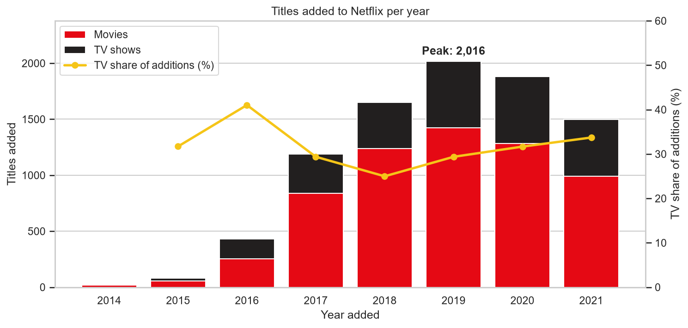
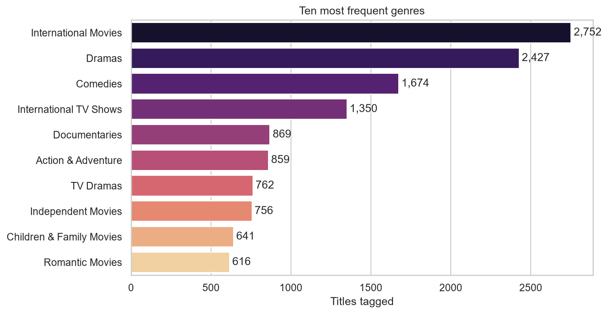

# Netflix Catalogue Exploratory Data Analysis

[](https://github.com/Haven-Pham/netflix-content-eda/actions/workflows/ci.yml)


## Overview

This project profiles the Netflix catalogue as of September 2021 (8,807 titles) from the point of view of a content
strategy team: what the library is made of, who it is aimed at, how it grew and where it is heading. The analysis
covers data cleaning, feature engineering and nine charts, each followed by an interpretation.

**Summary of results.** Films make up 70% of the catalogue, but series have taken a rising share of new additions
since 2018, from 25% to 34% in 2021. Two thirds of series never reached a second season. Adult-only ratings account
for 46% of titles, and nearly half of all titles are tagged *International*. India is the second-largest source
country after the United States.



## Questions

1. Is the catalogue built around films or series, and how long are they?
2. Which audiences do the ratings target?
3. When did Netflix add most of its titles, and is the content mix shifting?
4. Which genres, countries and directors dominate?
5. Which themes recur in title descriptions?

## Approach

- **Cleaning.** Three stand-up specials had their running time recorded in the `rating` column. These values were
  moved back to `duration` rather than deleting the rows. Missing `director`, `cast`, `country` and `rating` values
  became `Unknown`. The 10 titles without a valid `date_added` were removed (8,797 titles remain).
- **Feature engineering.** Year and month added, a numeric duration (minutes for films, seasons for series) and
  description length.
- **Multi-value fields.** `listed_in`, `country` and `director` hold comma-separated lists. They are split and exploded
  before counting, so a co-production counts once for each country.

## Key Findings

| Area | Finding |
|---|---|
| Content mix | 6,131 films (69.7%) and 2,666 series (30.3%) |
| Length | Median film runs 98 minutes; 67.3% of series have a single season |
| Audience | TV-MA is the most common rating (3,205 titles); adult-only ratings cover 45.5% of titles |
| Growth | Additions peaked in 2019 (2,016 titles); the TV share of additions rose from 25% in 2018 to 34% in 2021 |
| Seasonality | July and December receive the most titles, February the fewest |
| Genres | International Movies (2,752), Dramas (2,427) and Comedies (1,674) lead; 46.6% of titles carry an International tag |
| Countries | United States (3,684), India (1,046), United Kingdom (805) |



## Implications for Content Strategy

1. **Plan for series, not only films.** The stock is film-heavy, but new additions are shifting toward series. Budgets
   based on the current mix would underweight series.
2. **Treat renewals as a separate decision.** With two thirds of series ending after one season, renewal analysis
   matters as much as acquisition.
3. **Adults first, kids as a distinct shelf.** Mature ratings lead. Family content can be curated and promoted
   separately.
4. **Regional sourcing is a growth lever.** International titles are close to half of the catalogue, and India
   is the second-largest supplier.

## Deliverables

| File | Description |
|---|---|
| [`notebooks/netflix_content_eda.ipynb`](notebooks/netflix_content_eda.ipynb) | Complete analysis with outputs |
| [`reports/Netflix_Catalogue_EDA_Results.xlsx`](reports/Netflix_Catalogue_EDA_Results.xlsx) | Excel workbook: summary sheet with key findings, plus key findings, additions by year, ratings, genres and countries |
| [`reports/figures/`](reports/figures), [`reports/tables/`](reports/tables) | Charts (PNG) and result tables (CSV) |

## Repository Structure

```text
netflix-content-eda/
├── data/                    netflix_titles.csv and data dictionary
├── notebooks/               netflix_content_eda.ipynb (analysis with outputs)
├── reports/
│   ├── Netflix_Catalogue_EDA_Results.xlsx  (Excel results workbook)
│   ├── figures/             nine charts used in the analysis
│   └── tables/              key findings and country ranking (CSV)
├── scripts/                 run_notebook.py, build_excel_report.py
└── requirements.txt
```

## Reproducing the Analysis

```bash
pip install -r requirements.txt
python scripts/run_notebook.py        # re-run the analysis, refresh figures and tables
python scripts/build_excel_report.py  # rebuild the Excel workbook
```

The workflow in `.github/workflows/ci.yml` re-runs the notebook and rebuilds the workbook on every push.

## Data

`netflix_titles.csv` is the public *Netflix Movies and TV Shows* dataset (Kaggle, collected in September 2021).
Field definitions are in [`data/README.md`](data/README.md).

## Limitations

- The data show what Netflix *listed*, not what subscribers *watched*, so they say nothing about popularity or
  retention.
- Many titles have no director or country. Those rankings cover only titles with known values.
- 2021 covers January to September only.

## Author

Pham Hong Hieu (Haven) · [Portfolio](https://haven-portfolio02.vercel.app) · [LinkedIn](https://www.linkedin.com/in/havenpham) · [GitHub](https://github.com/Haven-Pham)
